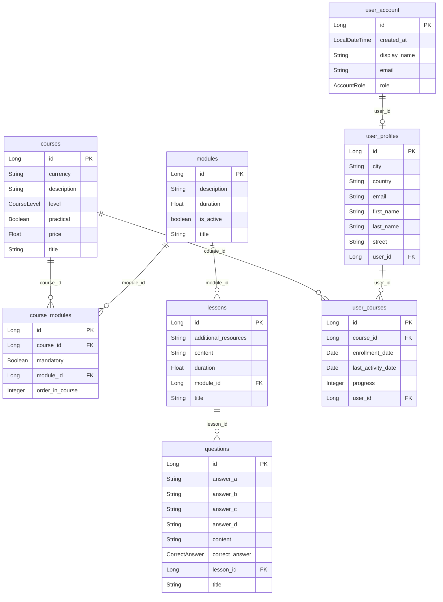

# Schemat bazy danych

Plik generują reguły projektu (panel Maven → Lifecycle → verify). Nie edytujcie go ręcznie.

Tabele: 8 · kolumny: 51 · relacje: 6 × @ManyToOne, 2 × @OneToMany, 1 × @OneToOne, 0 × @ManyToMany

| Tabela | Encja | Kolumny | Klucze obce |
|---|---|---|---|
| course_modules | CourseModule | 5 | course_id, module_id |
| courses | Course | 7 | — |
| lessons | Lesson | 6 | module_id |
| modules | Module | 5 | — |
| questions | Question | 9 | lesson_id |
| user_account | UserAccount | 5 | — |
| user_courses | UserCourse | 6 | course_id, user_id |
| user_profiles | UserProfile | 8 | user_id |

